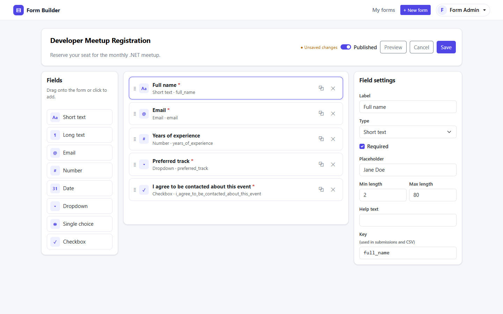
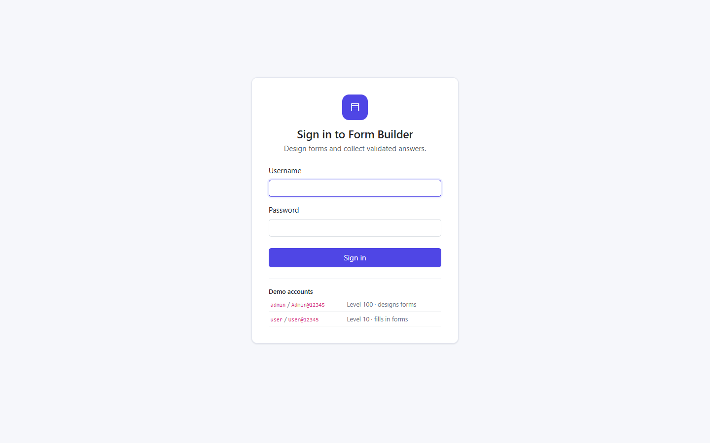
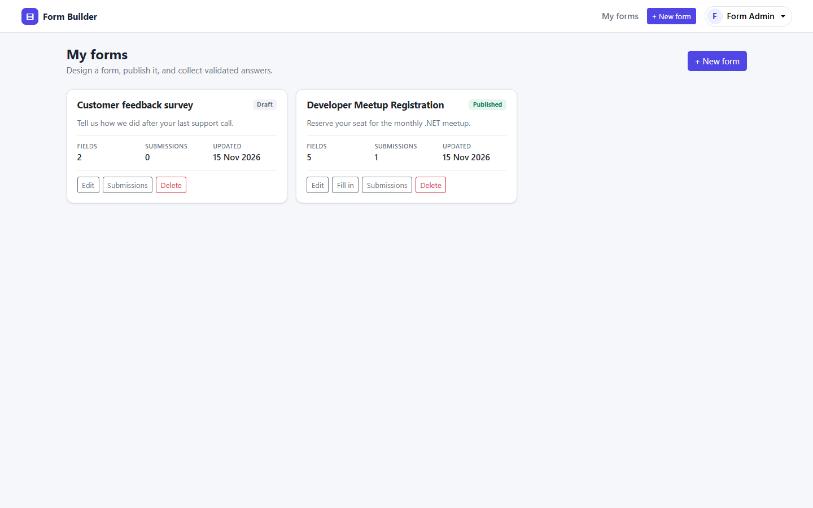
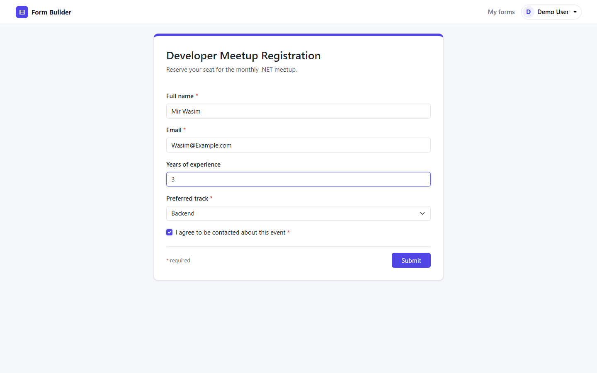
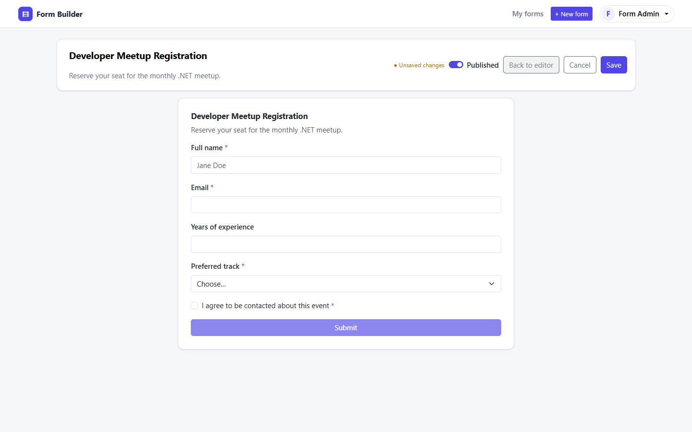
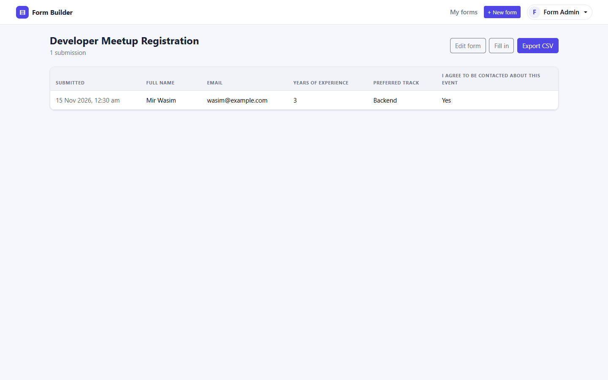
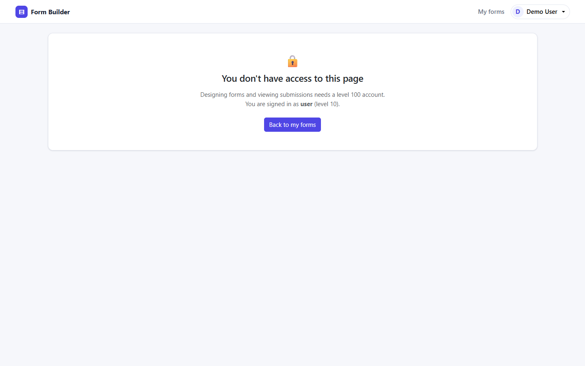
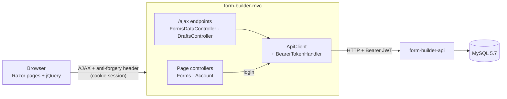
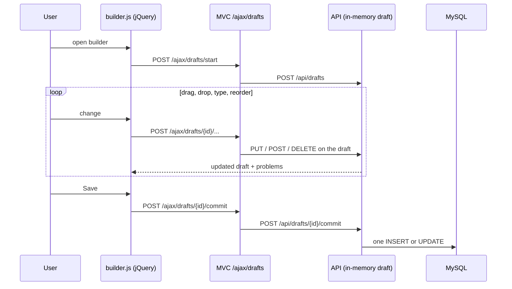

# Form Builder – ASP.NET Core MVC

[](https://github.com/GITHUB_USER/form-builder-mvc/actions/workflows/ci.yml)


The web front end of a **drag-and-drop form builder**, built with ASP.NET Core MVC, jQuery AJAX and jQuery UI.
Sign in, design a form by dragging fields onto a canvas, publish it, let users fill it in, and review or export the
answers.

This app has **no database access at all**. Every piece of data comes from
**[form-builder-api](https://github.com/GITHUB_USER/form-builder-api)** (.NET 9 + MySQL 5.7), called server-side with
the signed-in user's JWT.



---

## Features

- **Login with JWT** – the login page calls the API, which returns a signed token. The MVC app keeps the token inside
  its encrypted, HttpOnly authentication cookie, so page scripts can never read it.
- **Role-based access** – only users with **level 100** can design forms, delete them and view submissions; the menu,
  the pages (`[Authorize(Policy = "FormCreator")]`) and the API all enforce it.
- **Drag-and-drop builder** – drag field types from the palette onto the form (jQuery UI draggable → sortable), reorder
  by dragging the handle, duplicate, delete, edit settings in a side panel, preview.
- **Nothing is saved until you press Save** – each change is an AJAX call that updates an in-memory draft on the API;
  typing is debounced; *Save* writes the whole form to MySQL once. Problems (missing label, no options…) are listed
  live before saving.
- **Fill in** – any published form is rendered from its JSON definition, checked in the browser for instant feedback,
  and validated again by the API; server messages appear under the matching field.
- **Submissions** – table with one column per field and CSV export.
- **Security** – anti-forgery tokens on every POST (jQuery sends them as a header), open-redirect protection on
  sign-in, `X-Frame-Options`, `X-Content-Type-Options`, `Referrer-Policy`, all user content HTML-escaped.

| Sign in | My forms | Fill in |
| --- | --- | --- |
|  |  |  |

| Preview | Submissions | Level 10 user |
| --- | --- | --- |
|  |  |  |

## How it fits together



1. **Sign-in:** `AccountController` posts the credentials to `POST /api/auth/login`. On success it signs the user in
   with a cookie holding their claims (`level`, role) and the access token.
2. **Pages:** Razor views render the layout; each page loads its data with jQuery from `/ajax/...` endpoints.
3. **AJAX endpoints** check the policy, then forward the call to the API; `BearerTokenHandler` attaches the user's JWT.
   The API's status code and JSON (including RFC 7807 validation problems) go back to the page unchanged.
4. **Expired token:** if the API answers 401, the MVC session is ended and the page sends the user to sign in again.

### Builder: in memory until Save



## Tech stack

| Area | Technology |
| --- | --- |
| Server | ASP.NET Core 9 MVC, Razor views, cookie authentication, typed `HttpClient` |
| Client | jQuery 3.7 (AJAX), jQuery UI 1.14 (drag and drop), Bootstrap 5.3 |
| Tests | xUnit + `WebApplicationFactory` with a stub API; Playwright (Microsoft Edge) end-to-end test |
| Delivery | Docker, docker-compose (MySQL + API + MVC), GitHub Actions |

## Getting started

**Prerequisites:** .NET 9 SDK, Docker, and [form-builder-api](https://github.com/GITHUB_USER/form-builder-api) cloned
next to this folder.

```bash
# 1. database + API (in form-builder-api)
docker compose up -d mysql
dotnet run --project src/FormBuilder.Api --launch-profile http        # http://localhost:5080

# 2. this app
git clone https://github.com/GITHUB_USER/form-builder-mvc.git
cd form-builder-mvc
dotnet run --project src/FormBuilder.Mvc --launch-profile http        # http://localhost:5090
```

Sign in at **http://localhost:5090** with a demo account:

| Username | Password | Level | Can |
| --- | --- | --- | --- |
| `admin` | `Admin@12345` | 100 | design forms, view and export submissions |
| `user` | `User@12345` | 10 | fill in published forms |

**Or run everything in Docker** (both repositories side by side):

```bash
cd form-builder-mvc
docker compose up --build        # MySQL 5.7 + API + MVC on http://localhost:8080
```

The API address is set with `Api:BaseUrl` (default `http://localhost:5080/`).

## Tests

```bash
dotnet test                      # 22 tests, no API or database needed
```

`FormBuilder.Mvc.Tests` hosts the site in memory and replaces the API with a stub, checking:

- pages redirect to sign-in; AJAX calls get 401/403 instead of HTML redirects
- login success, wrong password, API down, missing anti-forgery token, open-redirect protection, sign-out
- level 10 users cannot open the builder or submissions, and their blocked AJAX calls **never reach the API**
- AJAX calls are forwarded with `Authorization: Bearer <user's token>` to the right API route and verb
- validation problems and CSV downloads pass through unchanged; an expired token ends the session; security headers

**End-to-end test in a real browser** (needs MySQL, the API and this app running):

```bash
cd tests/e2e
npm install
npm test                         # drives Microsoft Edge; BROWSER_CHANNEL=chrome for Chrome
```

It signs in, builds a form by dragging fields, checks through the API that **nothing is stored until Save and that
Save stores it once**, signs in as a level 10 user, is refused the builder, fills in the form (client and server
validation), then checks the submission, the table and the CSV download – 18 checks, and the screenshots above.

## Project structure

```text
src/FormBuilder.Mvc
├── Api                  # ApiClient (typed HttpClient), BearerTokenHandler
├── Auth                 # FormCreator policy, cookie sign-in, claims helpers
├── Controllers
│   ├── AccountController.cs        # login / logout / access denied
│   ├── FormsController.cs          # pages
│   └── Ajax                        # endpoints called by jQuery, forwarded to the API
├── Views                # Razor views (Bootstrap 5)
└── wwwroot/js
    ├── site.js          # AJAX setup, anti-forgery header, 401 handling, toasts, escaping
    ├── builder.js       # drag-and-drop builder (jQuery UI), debounced edits, queued calls
    ├── renderer.js      # renders a form definition, reads and validates answers
    ├── fill.js · forms-list.js · submissions.js
tests
├── FormBuilder.Mvc.Tests   # xUnit
└── e2e                     # Playwright browser test
```

## License

[MIT](LICENSE) © 2026 Mir Wasim Masoudhi. jQuery, jQuery UI and Bootstrap are included under their own MIT licenses.
